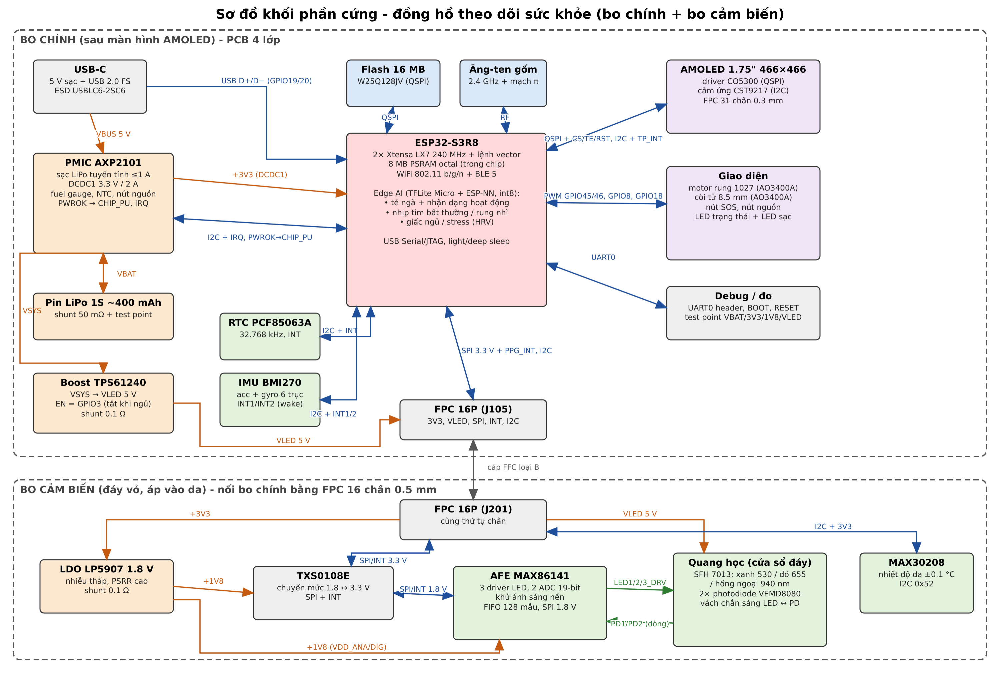
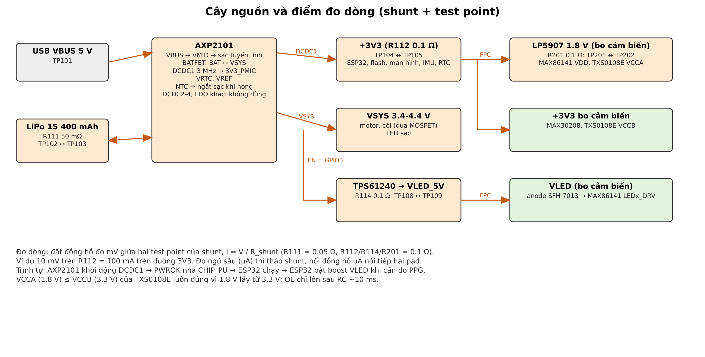
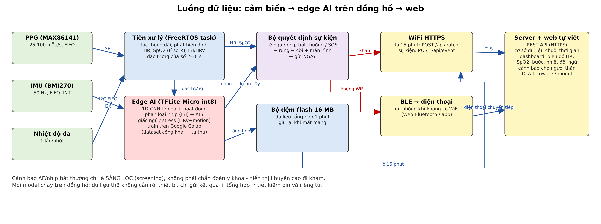

# Báo cáo phân tích thiết kế - Đồng hồ đeo tay theo dõi sức khỏe (edge AI + web)

Phiên bản 1.0 - 2026-11-04. Thiết kế đã chốt sau 7 vòng audit hỏi-đáp với người làm đồ án. Báo cáo sinh tự động bởi `tools/gen_report.py` từ `tools/design.py` (linh kiện, net, lý do, trích dẫn) và `tools/facts.py` (số liệu datasheet đã đối chiếu trang).

## 1. Tóm tắt

Đồng hồ đo **nhịp tim, SpO2, nhiệt độ da, chuyển động**, chạy **3 nhóm model AI ngay trên đồng hồ** (té ngã + hoạt động, nhịp tim bất thường/rung nhĩ, giấc ngủ/stress) và gửi kết quả lên **web tự viết** qua WiFi HTTPS (lô 15 phút, sự kiện khẩn gửi ngay, dự phòng BLE → điện thoại).

| Hạng mục | Kết quả |
|---|---|
| Phần cứng | 2 PCB: bo chính (105 linh kiện) + bo cảm biến (28 linh kiện) nối FPC 16 chân |
| Bộ xử lý | ESP32-S3R8 (2 × LX7 240 MHz, 8 MB PSRAM, WiFi + BLE 5) + flash 16 MB |
| Cảm biến | MAX86141 + SFH 7013 + 2 × VEMD8080 (PPG), BMI270 (IMU), MAX30208 (nhiệt độ da) |
| Nguồn | AXP2101 + LiPo ~400 mAh, USB-C; boost 5 V riêng cho LED PPG |
| Ngân sách pin (ước tính) | **8.5 mA trung bình → ~40 giờ (1.7 ngày)** với 400 mAh × 85 % dùng được; đạt mục tiêu ≥ 1 ngày |
| Schematic | KiCad 9, phân cấp, **đi dây như vẽ tay** (tụ, thạch anh, RF, USB, LED, MOSFET, LDO/boost nối dây thật; nhãn chỉ cho tín hiệu giữa khối/trang): bo chính 4 trang, bo cảm biến 1 trang. **ERC 0 lỗi / 0 cảnh báo**, kết nối khớp `design.py` 100 % (396 + 129 chân) |
| Trích dẫn | 29 số liệu datasheet đã mở lại đúng trang PDF và khớp (script `tools/facts.py`) |
| Chưa làm | Layout PCB, đặt hàng, đo trên phần cứng, firmware, model AI, web |

File: `outputs/health_watch_main_schematic.pdf`, `outputs/health_watch_sensor_schematic.pdf`, `docs/img/block_diagram.png`, `docs/img/power_tree.png`, `docs/img/data_flow.png`; project KiCad trong `hardware/main`, `hardware/sensor`.

## 2. Quyết định thiết kế (kết quả audit)

| Câu hỏi | Quyết định | Lý do / hệ quả | Phương án không chọn |
|---|---|---|---|
| Mức độ hoàn thiện | PCB tự thiết kế, cỡ đồng hồ nhưng được phép to hơn (demo) | Có chỗ cho test point, shunt đo dòng, header debug | ghép module có sẵn |
| Đưa dữ liệu lên web | WiFi trực tiếp (ESP32-S3) + BLE | Không cần điện thoại để đồng bộ; tốn pin hơn BLE-only → giới hạn số lần bật WiFi | nRF52 BLE-only; 2 chip |
| Dạng chip | ESP32-S3R8 chip trần + anten gốm | Giống bo Waveshare 1.75C → dùng lại mạch RF/thạch anh/flash đã chạy; cần tune mạch π bằng VNA | module ESP32-S3-MINI-1 |
| Cảm biến | PPG + IMU + nhiệt độ da (không ECG) | Rung nhĩ phát hiện từ khoảng nhịp PPG → chỉ là sàng lọc | ECG MAX30003 |
| AFE PPG | MAX86141 + LED/PD rời (người làm chọn) | Tín hiệu tốt nhất, 2 PD chống nhiễu cử động; **WLP 0.4 mm bắt buộc PCBA** | MAXM86161, MAXM86146 |
| Edge AI | Cả 3: té ngã + hoạt động, nhịp bất thường, giấc ngủ/stress | Train trên Google Colab, int8, TFLite Micro + ESP-NN | chỉ 1 model |
| Màn hình | AMOLED 1.75" CO5300 QSPI + touch (như bản clone) | Dùng lại FPC, GPIO, code mẫu Waveshare | 1.43" tròn, LCD GC9A01 |
| Pin | ≥ 1 ngày, LiPo ~400 mAh | Ước tính 1.7 ngày (mục 7) | ≥ 3 ngày |
| Nguồn | PMIC AXP2101 | Sạc + DCDC + fuel gauge + nút nguồn trong 1 IC, có bo tham chiếu | BQ25180 + TPS62840 + MAX17048 |
| Sạc/nạp | USB-C (sạc + nạp + USB-JTAG) | Không cần chip USB-UART | pogo + đế sạc |
| Giao diện | Motor rung, 2 nút (nguồn, SOS), còi từ, RTC ngoài, LED trạng thái | Báo động không cần nhìn màn hình | loa I2S, codec + mic |
| IMU | BMI270 trên bo chính | Tính năng cổ tay, FIFO 2 KB; hai bo gắn cứng nên chuyển động giống nhau | QMI8658, LSM6DSOX |
| PCB | 4 lớp, 2 bo nối FPC | RF cần mặt GND liền; bo cảm biến riêng ở đáy vỏ áp da | 1 bo 2 mặt |
| Giao thức | HTTPS POST theo lô 15 phút; sự kiện khẩn gửi ngay; BLE → điện thoại khi mất WiFi | Đơn giản, web tự viết REST API | MQTT, WebSocket |
| Firmware | ESP-IDF + FreeRTOS | Quản lý nguồn tốt (auto light-sleep, tickless idle); cần cài lại ESP-IDF | Arduino core |

Bổ sung sau khi đọc datasheet (không đổi kiến trúc đã chốt):

- **Boost 5 V cho LED (TPS61240)**: LED xanh lá có VF tối đa 3.35 V (SFH p.3); cộng phần áp cho bộ lái dòng thì cần VLED ≥ ~3.85 V, nhưng pin LiPo về cuối chỉ còn ~3.4 V. MAX86141 cho VLED 3.1-5.5 V (MAX p.6) và đặc tả đo ở 5.0 V.
- **LDO 1.8 V + chuyển mức TXS0108E**: MAX86141 chạy 1.7-2.0 V (MAX p.6), chân SPI chịu tối đa 2.2 V (MAX p.4), không nối thẳng với ESP32 3.3 V được. Ngược lại, ESP32 cần VIH ≥ 0.75·VDD = 2.5 V (DS Table 5-4 p.65), nên mức 1.8 V của MAX86141 không đủ.
- **Địa chỉ I2C MAX30208 = 0x52**: mặc định 0x50 + 2 bit GPIO dễ trùng RTC 0x51 → nối cứng GPIO1 = 1, GPIO0 = 0 (M30 Table 3 p.10), đọc nhiệt độ theo chu kỳ, không dùng INT.

## 3. Kiến trúc

Hình 1. Sơ đồ khối phần cứng. Mũi tên xanh = tín hiệu (ghi giao tiếp), cam = nguồn, xanh lá = tín hiệu quang/analog.

Hình 2. Cây nguồn và điểm đo dòng.

Hình 3. Luồng dữ liệu từ cảm biến qua edge AI tới web.

## 4. Phân tích từng khối

### 4.1 Nguồn - AXP2101, pin, USB-C

- Mạch theo hình 7-1 của datasheet (AXP Fig 7-1 p.57) và bo Waveshare 1.75C (cùng chip): VSYS 2 × 22 µF (AXP p.8), BAT 1 µF, VBUS/VMID 10 µF, DCDC1 1 µH + 22 µF. DCDC2-4, ALDO/BLDO/DLDO không dùng: để trống như bo tham chiếu (WS p.1). Chân SW (DCDC5) giữ cấu trúc của Waveshare (L 1 µH về VSYS).
- **PWROK → CHIP_PU**: ESP32 chỉ chạy khi PMIC báo nguồn ổn định, kết hợp RC 10 kΩ/1 µF theo HDG §1.3.3 p.8.
- Dòng sạc đặt bằng thanh ghi ICHG của AXP2101; firmware đặt **200 mA ≈ 0.5C** cho pin 400 mAh (AXP p.23). NTC 10 kΩ trên chân TS ngắt sạc khi pin nóng.
- I2C hệ thống kéo lên 2.2 kΩ (yêu cầu của AXP2101, AXP p.9). Thời gian lên t_r = 0.8473·R·C = 0.8473 × 2.2 kΩ × 100 pF ≈ 186 ns < 300 ns (Fast-mode 400 kHz) với 5 thiết bị + FPC (C bus 100 pF: **ASSUME**).
- Shunt đo dòng: R111 50 mΩ (pin), R112 0.1 Ω (3V3), R114 0.1 Ω (VLED), R201 0.1 Ω (1V8). Sụt áp lớn nhất: 3V3 ở 400 mA → 40 mV (1.2 %), chấp nhận được; đo ngủ sâu thì tháo shunt, nối đồng hồ µA.

### 4.2 ESP32-S3R8, flash, RF

- Theo sơ đồ tham chiếu HDG Fig.1 p.5: VDD3P3 lọc LC 2.0 nH + 10 µF/1 µF/100 nF; VDDA 1 µF + 10 nF; thạch anh 40 MHz với 24 nH nối tiếp XTAL_P và tụ tải 22 pF (CL = 22·22/44 + ~4 pF ký sinh ≈ 15 pF, HDG §1.3.5 p.10-11).
- S3R8 không có flash trong chip → W25Q128JV 16 MB qua SPI0 (chân 30-35), VDD_SPI = 3.3 V vì GPIO45 = 0 khi reset (DS Table 3-4 p.34). Dùng cho OTA 2 phân vùng, model TFLite (~100-300 KB mỗi model, ASSUME) và bộ đệm dữ liệu offline.
- RF: mạch CLC phía chip (1.5 pF / 2.4 nH / 1.5 pF, HDG §1.3.6 Table 6 p.13) + mạch π phía ăng-ten (DNP / 0 Ω / DNP) để tune bằng VNA. Ăng-ten gốm Johanson 2450AT18A100 ở góc bo, cần vùng cấm đồng.
- USB D+/D− nối tiếp 22 Ω (HDG §1.3.13 p.18), ESD USBLC6-2SC6 sát cổng.

Bảng gán GPIO (giữ nguyên các chân màn hình/cảm ứng/I2C của Waveshare 1.75C):

| GPIO | Chân QFN | Net | Ghi chú |
|---|---|---|---|
| GPIO0 | 5 | BOOT | strapping, nút BOOT |
| GPIO1 | 6 | LCD_RST |  |
| GPIO2 | 7 | TP_RST |  |
| GPIO3 | 8 | VLED_EN | strapping (JTAG src), kéo xuống 100k |
| GPIO4 | 9 | QSPI_D0 |  |
| GPIO5 | 10 | QSPI_D1 |  |
| GPIO6 | 11 | QSPI_D2 |  |
| GPIO7 | 12 | QSPI_D3 |  |
| GPIO8 | 13 | BTN_SOS | RTC GPIO: đánh thức deep-sleep |
| GPIO9 | 14 | IMU_INT1 | RTC GPIO: wake (giơ tay, va chạm) |
| GPIO10 | 15 | PPG_INT | RTC GPIO: FIFO đầy |
| GPIO11 | 16 | TP_INT |  |
| GPIO12 | 17 | LCD_CS |  |
| GPIO13 | 18 | LCD_TE |  |
| GPIO14 | 19 | SYS_SCL | I2C0 |
| GPIO15 | 21 | SYS_SDA | I2C0 400 kHz |
| GPIO16 | 22 | AXP_IRQ | RTC GPIO: nút nguồn, sạc |
| GPIO17 | 23 | RTC_INT | RTC GPIO: hẹn giờ |
| GPIO18 | 24 | LED_STAT |  |
| GPIO21 | 27 | IMU_INT2 | RTC GPIO |
| GPIO38 | 43 | QSPI_CLK | QSPI màn hình (SPI2/3) |
| GPIO39 | 44 | PPG_SCLK | SPI2 qua GPIO matrix, ≤ 4 MHz (MAX p.8) |
| GPIO40 | 45 | PPG_MOSI |  |
| GPIO41 | 47 | PPG_MISO |  |
| GPIO42 | 48 | PPG_CS |  |
| GPIO45 | 51 | BUZZER | strapping VDD_SPI → phải 0 lúc reset (R123) |
| GPIO46 | 52 | MOTOR | strapping boot mode → phải 0 lúc reset (R121) |
| GPIO19/20 | 25/26 | USB_DN/DP | USB Serial/JTAG |
| U0TXD/RXD | 49/50 | U0TXD/U0RXD | header J103 |
| GPIO33-37 | 38-42 | - | PSRAM octal trong chip: không dùng |
| GPIO47/48 | 36/37 | - | miền VDD_SPI: để trống |

Bus I2C (7 bit): AXP2101 0x34, CST9217 touch 0x5A, BMI270 0x68, PCF85063A 0x51, MAX30208 0x52 - không trùng (kiểm trong `design.check()`).

### 4.3 Màn hình, IMU, RTC, giao diện

- FPC 31 chân 0.3 mm giống hệt J3 của Waveshare (WS p.1): QSPI GPIO4-7 + GPIO38, CS GPIO12, TE GPIO13, RST GPIO1; cảm ứng I2C + TP_INT GPIO11 + TP_RST GPIO2. Thêm 10 µF + 100 nF cạnh FPC.
- BMI270 ở chế độ I2C: CSB = VDDIO, SDO = GND → 0x68 (BMI Table 22 p.135, BMI p.128); ASDx/ASCx/OCSB/OSDO để trống (cho phép khi không dùng giao tiếp phụ). INT1/INT2 về RTC GPIO.
- Motor rung và còi từ đóng ngắt phía thấp bằng AO3400A, diode dập BAT54WS, cổng 100 Ω + kéo xuống 100 kΩ. Motor 3 V cấp từ VSYS (≤ 4.4 V): duty PWM D ≤ 3.0/4.2 ≈ 71 % khi pin đầy.
- Nút SOS GPIO8 (kéo lên 10 kΩ + 100 nF ≈ 1 ms chống dội), nút nguồn vào PWRON của AXP2101 (510 Ω + 1 nF như Waveshare). LED đỏ sạc do AXP2101 lái (CHGLED), LED xanh trạng thái GPIO18.

### 4.4 Bo cảm biến - chuỗi PPG

- **Quang học**: SFH 7013 (xanh 530 nm cho nhịp tim ở cổ tay, đỏ 655 + IR 940 nm cho SpO2) ở giữa, 2 photodiode VEMD8080 hai bên; cần vách chắn sáng giữa LED và PD và cửa sổ kính/acrylic mỏng. LED1_DRV = xanh, LED2 = đỏ, LED3 = IR; PD1/PD2 đọc đồng thời (MAX p.12).
- **Nguồn AFE**: LP5907 1.8 V nhiễu thấp từ 3V3 (Iq 12 µA, LP p.6); VDD_ANA 0.1 µF + 10 µF, VDD_DIG 0.1 µF, VREF 1 µF, VLED 10 µF (MAX p.12).
- **Chuyển mức**: TXS0108E VCCA 1.8 V / VCCB 3.3 V, kênh 1-5 = SCLK, SDI, SDO, CSB, INT. Điện trở kéo lên nội 4 k/40 k (TXS p.18) nên INT cực máng hở vẫn hoạt động; OE nối VCCA qua RC 100 kΩ × 100 nF = 10 ms để chỉ bật sau khi hai nguồn ổn định (TXS p.20). SPI 4 MHz nằm trong khả năng của TXS0108E (110 Mbps push-pull, 1.2 Mbps open-drain - đủ cho INT; TXS p.1).
- **MAX30208**: cấp từ +3V3 luôn bật (không cấp từ nguồn bị cắt, tránh I2C cấp ngược vào IC không có nguồn), địa chỉ 0x52, đặt sát tấm tiếp xúc da và xa LDO/LED.
- **FPC 16 chân**: GND ở chân 1, 4, 7, 13, 16 tách nhóm VLED / SPI / I2C; dùng cáp FFC loại B (tiếp điểm hai đầu ngược mặt) để chân 1 ↔ chân 1 khi hai đầu nối cùng nằm mặt trên.

## 5. Edge AI và firmware

| Model | Đầu vào | Kiến trúc (đề xuất) | Dữ liệu train | Chạy khi nào |
|---|---|---|---|---|
| Té ngã + hoạt động (đi, chạy, ngồi, nằm, cầu thang) | acc + gyro 50 Hz, cửa sổ 2.56 s | 1D-CNN 3 lớp, int8, ~20-50 KB | UMAFall / WEDA-FALL (cổ tay) + tự thu (ngã lên nệm) | mỗi 2 s khi FIFO đầy; INT va chạm đánh thức |
| Nhịp tim bất thường / rung nhĩ | chuỗi IBI từ PPG 30-60 s + đặc trưng HRV | MLP/1D-CNN nhỏ trên IBI | MIMIC PERform AF, MIT-BIH AF (chuyển R-R → IBI) | mỗi 5 phút khi đứng yên (IMU) |
| Giấc ngủ / stress | HRV (RMSSD, LF/HF) + mức vận động 30 s | cây quyết định / MLP | WESAD (stress), tự ghi nhật ký ngủ | ban đêm, mỗi epoch 30 s |

- Quy trình: thu dữ liệu → Google Colab (Keras) → lượng tử hóa int8 → TFLite Micro + ESP-NN trên ESP32-S3 → đánh giá trên tập kiểm tra và trên đồng hồ thật. 8 MB PSRAM chứa tensor arena và bộ đệm cửa sổ.
- Task FreeRTOS: `sensor_task` (đọc FIFO theo INT), `dsp_task` (lọc, HR, SpO2, IBI), `ai_task` (3 model), `event_task` (rung/còi/màn hình), `net_task` (HTTPS/BLE, chỉ bật khi cần), `ui_task` (LVGL). Phần còn lại ở auto light-sleep (ESP-IDF power management).
- Web: REST API `POST /api/batch` (JSON 15 phút: HR, SpO2, bước, nhiệt độ, nhãn hoạt động) và `POST /api/event` (té ngã/AF/SOS, kèm vị trí thời gian); token thiết bị trong NVS, TLS.
- **Giới hạn y khoa**: cảnh báo rung nhĩ từ PPG chỉ là sàng lọc, không phải chẩn đoán; giao diện phải ghi khuyến cáo đi khám.

## 6. Phân tích tín hiệu PPG - biên áp LED

VLED_min = VF_max + V_headroom = 3.35 V + 0.5 V (**ASSUME**, đồ thị "suggested LED driver headroom" MAX p.10) = 3.85 V. Pin LiPo 3.4-4.2 V không đảm bảo → boost 5 V. Công suất LED: I_LED,TB × 5 V / (η 85 % × 3.7 V) quy về pin (đã tính trong mục 7).

## 7. Ngân sách pin

Giả thiết: pin 3.7 V danh định, hiệu suất DCDC1 90 %, boost 85 %, dung lượng 400 mAh × 85 % dùng được. Dòng ở 3V3 quy về pin: I_bat = I × 3.3 / (3.7 × 0.90).

| Tải | mA TB ở pin | Cách tính | Nguồn số liệu |
|---|---|---|---|
| ESP32-S3 light-sleep nền | 0.238 | 0.240 mA × 100 % thời gian | DS p.68 |
| Màn hình AMOLED sáng (5 % thời gian) | 1.982 | 40 mA × 5 % (giơ tay xem ~72 phút/ngày) | ASSUME: chưa có datasheet panel; đo bằng R112 |
| ESP32 chạy giao diện khi màn sáng | 3.176 | 64.1 mA × 5 % | DS p.67 |
| AI té ngã/hoạt động (mỗi 2 s, 20 ms @240 MHz) | 0.806 | 81.3 mA × 1 % | DS p.67; thời gian suy luận ASSUME |
| Xử lý PPG + HR mỗi 1 s (5 ms @160 MHz) | 0.318 | 64.1 mA × 0.5 % | DS p.67; ASSUME |
| WiFi HTTPS: 96 lần/ngày × 3 s × 120 mA | 0.396 | kết nối + TLS + POST; TB giữa RX 88 mA / TX đỉnh 283 mA | DS p.66; 120 mA TB và 3 s là ASSUME |
| LED PPG xanh, 25 sps liên tục (ngày) | 0.196 | 0.185 mA ở VLED × 16 h | MAX p.7 |
| LED PPG 100 sps ban đêm (HRV giấc ngủ) | 0.390 | 0.735 mA ở VLED × 8 h | MAX p.7 |
| SpO2 đo nhanh 30 s mỗi 10 phút (đỏ + IR) | 0.117 | 2 LED × 0.735 mA × 5 % | MAX p.7 |
| MAX86141 VDD (1.8 V) | 0.023 | AFE 0.011 + LDO Iq 0.012 mA | MAX p.7, LP p.6 |
| Boost TPS61240 Iq khi bật (24 h) | 0.030 | 0.030 mA từ VSYS | TPS p.5 |
| BMI270 acc + gyro normal | 0.679 | 0.685 mA (gyro cần cho té ngã) | BMI p.11 |
| AXP2101 tĩnh khi chạy | 0.100 | ~0.1 mA | ASSUME (datasheet chỉ ghi 40 µA khi tắt, AXP p.11) |
| MAX30208, RTC, TXS0108E, pull-up | 0.010 | ~0.01 mA | M30 p.1; còn lại ASSUME |
| Motor/còi: 10 cảnh báo × 2 s × 80 mA | 0.019 | từ VSYS | ASSUME |
| **Tổng** | **8.48** |  |  |

**Thời gian chạy ≈ 400 × 0.85 / 8.48 ≈ 40 giờ ≈ 1.7 ngày.** So sánh thiết kế "ngây thơ" (không ngủ): 125 mA → 2.7 giờ, tức tiết kiệm 15 lần nhờ light-sleep, màn hình tắt, WiFi theo lô.

| Thiết kế ngây thơ | mA ở pin |
|---|---|
| Màn hình luôn sáng | 39.6 |
| CPU luôn chạy 160 MHz, không ngủ | 63.5 |
| WiFi luôn kết nối (modem ~20 mA TB) | 19.8 |
| PPG 100 sps liên tục | 1.2 |
| IMU + các IC khác | 0.8 |

Ba mục lớn nhất cần đo sớm bằng shunt: màn hình (R112), LED PPG (R114), IMU. Nếu màn hình > 60 mA khi sáng thì giảm độ sáng/thời gian sáng trước.

## 8. Kiểm tra đã làm

| Kiểm tra | Kết quả |
|---|---|
| ERC KiCad 9 (lỗi + cảnh báo), cả 2 bo | 0 vi phạm |
| Netlist KiCad so với design.py: mỗi net thiết kế = đúng một net KiCad, cùng tập chân | 0 sai khác (`tools/check_net.py`); vài net nối dây ngắn giữ tên tự động của KiCad |
| Chân mỗi symbol mới so với bảng chân datasheet | MAX86141 (MAX p.11-12), MAX30208 (M30 p.6), BMI270 (BMI p.135), TPS61240 (TPS p.3), VEMD8080 (VEMD p.4), SFH 7013 (SFH p.9); AXP2101 so với Table 4-1 p.7-9 |
| Số liệu trích dẫn | 29/29 khớp đúng trang PDF (`tools/facts.py`) |
| Địa chỉ I2C, sơ đồ chân FPC hai bo | không trùng / giống nhau (`design.check()`) |
| Chưa kiểm | layout PCB, DRC, chạy thật, firmware, đo dòng |

## 9. Rủi ro và việc còn mở

| # | Rủi ro / việc | Mức | Xử lý |
|---|---|---|---|
| 1 | MAX86141 WLP 0.4 mm: không hàn tay; LCSC chỉ còn ~30 con, SFH 7013 hết hàng ở LCSC (4/11/2026) | Cao | Đặt PCBA 2 mặt có via-in-pad; mua sớm hoặc qua DigiKey/Mouser; LED thay thế: 1 LED xanh + 1 LED đỏ/IR rời |
| 2 | Datasheet PCF85063A (NXP) chưa tải được - pinout lấy từ thư viện KiCad | TB | Tải PDF NXP thủ công vào docs/datasheets rồi đối chiếu chân, tụ tải 7 pF, địa chỉ 0x51 |
| 3 | Footprint MAX30208 LGA-10 là bản sơ bộ; pad MAX86141 0.25 mm theo AN1891 (ASSUME) | Cao | Lấy land pattern ADI 90-100101 và outline 21-100134 trước khi đặt PCB |
| 4 | Ăng-ten gốm trên bo nhỏ, cạnh pin và màn hình | TB | Vùng cấm đồng theo datasheet ăng-ten, đo S11 bằng VNA, chỉnh mạch π C130/R117/C131 |
| 5 | Dòng màn hình AMOLED chưa có số liệu (giả định 40 mA) | TB | Đo bằng shunt R112 trên bo Waveshare có sẵn |
| 6 | Cáp FFC giữa 2 bo: sai loại A/B sẽ đảo chân | TB | Ghi rõ loại B trên silkscreen, kiểm thông mạch trước khi cấp nguồn |
| 7 | Phát hiện rung nhĩ từ PPG chỉ là sàng lọc; dataset ECG ≠ PPG | TB | Báo cáo độ nhạy/độ đặc hiệu trên tập kiểm tra, ghi rõ giới hạn |
| 8 | Chân SW/DCDC5 của AXP2101 nối theo Waveshare, chưa có giải thích trong datasheet | Thấp | Giữ như bo đã chạy; kiểm DCDC5 tắt bằng thanh ghi |
| 9 | ESP-IDF đã gỡ khỏi máy (25/10) | Thấp | Cài lại khi bắt đầu firmware |

## 10. Danh sách linh kiện theo khối (từ design.py)

### Health watch - main board

**USB-C + ESD**

| Ref | Giá trị | Vai trò | Tài liệu |
|---|---|---|---|
| J101 | TYPE-C-31-M-12 | USB-C duy nhất: sạc pin (VBUS → AXP2101) + nạp/debug firmware qua USB Serial/JTAG của ESP32-S3. | TYC; HDG §1.3.13 |
| R101 | 5.1k | Rd 5.1 kΩ trên CC1: thiết bị là sink, sạc USB-C mới cấp 5 V. | USB Type-C spec (Rd = 5.1 kΩ) |
| R102 | 5.1k | Rd 5.1 kΩ trên CC2 (cắm ngược). | USB Type-C spec |
| U101 | USBLC6-2SC6 | Chống ESD cho D+/D− và VBUS ngay sau cổng (1-6, 3-4 là hai đầu của cùng một đường). | LC6 p.1; HDG §1.3.13 |
| R103 | 22 | Điện trở nối tiếp D− 22 Ω sát chip. | HDG §1.3.13; WS p.1 (R13) |
| R104 | 22 | Điện trở nối tiếp D+ 22 Ω. | HDG §1.3.13; WS p.1 (R14) |
| TP101 | TP | Đo VBUS. |  |

**PMIC AXP2101 + pin + shunt đo dòng**

| Ref | Giá trị | Vai trò | Tài liệu |
|---|---|---|---|
| U102 | AXP2101 | PMIC: sạc tuyến tính 100 mA–1 A cho LiPo, DCDC1 3.3 V (2 A) cho toàn hệ thống, đo % pin (fuel gauge), nút nguồn, IRQ; PWROK giữ ESP32 ở reset tới khi nguồn ổn định (giống bo Waveshare). DCDC2-4, các LDO không dùng: để trống như bo tham chiếu. | AXP p.1 (features), Table 4-1 p.7-9 (chân), Fig 7-1 p.57 (mạch ứng dụng); WS p.1 |
| C101 | 10uF 10V | Tụ VBUS 10 µF/10 V. | AXP Fig 7-1 p.57 |
| C102 | 10uF 10V | Tụ VMID (sau RBFET) 10 µF/10 V, như bo Waveshare. | AXP Fig 7-1 p.57; WS p.1 (CP2) |
| C103 | 22uF 6.3V | VSYS: hai tụ 22 µF sát chân SYS. | AXP Table 4-1 p.8 (pin 34) |
| C104 | 22uF 6.3V | Tụ 22 µF thứ hai trên VSYS. | AXP Table 4-1 p.8 (pin 34) |
| C105 | 1uF | Tụ 1 µF sát chân BAT. | AXP Table 4-1 p.8 (pin 33) |
| C106 | 1uF | Tụ VREF 1 µF. | AXP Fig 7-1 p.57 |
| C107 | 1uF | Tụ VRTC 1 µF. | AXP Fig 7-1 p.57 |
| C108 | 2.2uF | VBackup: không dùng pin dự phòng, chỉ tụ 2.2 µF như bo Waveshare. | WS p.1 (CP13); AXP Fig 7-1 p.57 |
| C109 | 1uF | Tụ vào VIN1 (DCDC1) 1 µF. | AXP Fig 7-1 p.57 |
| C110 | 1uF | Tụ vào ALDOIN 1 µF. | AXP Fig 7-1 p.57 |
| L101 | 1uH 2.5A | Cuộn DCDC1 1 µH (3 MHz); Isat ≥ 2.5 A cho tải đỉnh WiFi + màn hình. | AXP Fig 7-1 p.57, §6.6 p.22 (3 MHz) |
| C111 | 22uF 6.3V | Tụ ra DCDC1 22 µF, FB1 lấy tại đây. | AXP Fig 7-1 p.57 |
| L102 | 1uH 2.5A | Chân SW (DCDC5) nối như bo Waveshare đã chạy thực tế (cuộn 1 µH về VSYS); DCDC5 không dùng làm nguồn. | WS p.1 (LP2, RP2); AXP Fig 7-1 p.57 |
| R105 | 0R | 0 Ω (Waveshare dùng 0.01 Ω ở vị trí này) - giữ nguyên cấu trúc bo tham chiếu. | WS p.1 (RP2) |
| RT101 | NTC 10k B3950 | NTC 10 kΩ đặt sát pin: AXP2101 ngắt sạc khi pin quá nóng/lạnh. | AXP Table 4-1 p.8 (pin 31 TS); WS p.1 (RP4) |
| R106 | 4.7k | Kéo lên IRQ (cực máng hở) 4.7 kΩ. | AXP Table 4-1 p.8 (pin 38) |
| R107 | 2.2k | Kéo lên I2C SDA 2.2 kΩ (bus chung: AXP2101, touch, BMI270, RTC, MAX30208). | AXP Table 4-1 p.9 (pin 39 "needs a 2.2kΩ pull high") |
| R108 | 2.2k | Kéo lên I2C SCL 2.2 kΩ. | AXP Table 4-1 p.9 (pin 40) |
| R109 | 510 | Nối tiếp nút nguồn 510 Ω như bo Waveshare. | WS p.1 (RP6) |
| C112 | 1nF | Lọc nhiễu nút nguồn 1 nF. | WS p.1 (CP14) |
| SW101 | TS-1088 4x3mm | Nút nguồn: nhấn ngắn = bật/đánh thức (IRQ), giữ lâu = tắt (AXP2101 xử lý). | AXP Table 4-1 p.8 (pin 30 PWRON, kéo lên 100k nội) |
| R110 | 1k | Hạn dòng LED sạc ≈ (4.0−2.0)/1k ≈ 2 mA. | AXP Fig 7-1 p.57 (LED từ VSYS về CHGLED) |
| D101 | Red 0603 | LED đỏ báo sạc (AXP2101 điều khiển chân CHGLED cực máng hở; firmware có thể tự điều khiển). | AXP Table 4-1 p.7 (pin 1) |
| J102 | LiPo 1S ~400mAh | Đầu nối pin LiPo 1S (Molex PicoBlade 1.25 mm); pin có sẵn mạch bảo vệ. Chân 1 = +. |  |
| R111 | 0.05R 1% 0805 | Shunt 50 mΩ đo dòng pin: I = V(TP2−TP3)/0.05; 0.3 A chỉ sụt 15 mV. | yêu cầu đo dòng (user) |
| TP102 | TP | Đo dòng pin: đầu pin của shunt. |  |
| TP103 | TP | Đo dòng pin: đầu AXP của shunt. |  |
| R112 | 0.1R 1% 0603 | Shunt 0.1 Ω đo dòng 3V3 toàn hệ thống (ESP32 + màn hình + cảm biến). | yêu cầu đo dòng (user) |
| TP104 | TP | Đo dòng 3V3: phía DCDC1. |  |
| TP105 | TP | Đo dòng 3V3: phía tải. |  |
| TP106 | TP | Đo VSYS. |  |
| TP107 | TP | GND cho que đo. |  |

**Boost 5 V cho LED PPG**

| Ref | Giá trị | Vai trò | Tài liệu |
|---|---|---|---|
| U103 | TPS61240DRVT | Boost 5 V cấp VLED cho LED PPG: LED xanh lá có VF tới 3.35 V + áp cần cho driver, pin LiPo xuống 3.4 V thì không đủ. Datasheet MAX86141 đo ở VLED = 5.0 V. EN do ESP32 bật chỉ khi đo PPG. | TPS p.1, p.3 (chân), §10.2.2 p.12 (CIN 2.2 µF, COUT 4.7 µF, L 1 µH); MAX p.6 (VLED 3.1-5.5 V); SFH p.3 (VF green max 3.35 V) |
| L103 | 1uH 1A | Cuộn boost 1 µH. | TPS §10.2.2 p.12 (L = 1 µH) |
| C113 | 2.2uF | Tụ vào boost 2.2 µF. | TPS §10.2.2 p.12 |
| C114 | 4.7uF | Tụ ra boost 4.7 µF. | TPS §10.2.2 p.12 |
| R113 | 100k | Kéo xuống EN: boost tắt khi ESP32 reset/ngủ. GPIO3 là chân strapping (nguồn tín hiệu JTAG) - mức thấp không ảnh hưởng khi eFuse mặc định. | DS §3 Table 3-1 p.32 (GPIO3 strapping) |
| R114 | 0.1R 1% 0603 | Shunt 0.1 Ω đo dòng LED PPG. | yêu cầu đo dòng (user) |
| TP108 | TP | Đo dòng VLED: phía boost. |  |
| TP109 | TP | Đo dòng VLED: phía tải. |  |

**ESP32-S3R8 + flash + thạch anh + reset/boot**

| Ref | Giá trị | Vai trò | Tài liệu |
|---|---|---|---|
| U104 | ESP32-S3R8 | SoC 2 nhân Xtensa LX7 240 MHz, lệnh vector cho AI (ESP-NN), 8 MB PSRAM octal trong chip, WiFi 2.4 GHz + BLE 5. Flash ngoài 16 MB (U5) chứa firmware, model AI và bộ đệm dữ liệu khi mất mạng. | DS p.2 (features), Table 1-1 (R8 = 8 MB PSRAM), Table 2-1 (chân) |
| C115 | 10uF 10V | VDD3P3 (PA RF): 10 µF. | HDG §1.3.2 p.8 |
| C116 | 1uF | VDD3P3 1 µF. | HDG Fig.1 p.5 |
| C117 | 100nF | VDD3P3 100 nF sát chân 2/3. | HDG Fig.1 p.5 |
| L104 | 2.0nH | Lọc LC VDD3P3 2.0 nH (≥500 mA). | HDG §1.3.2 p.8; WS p.1 (IND1 2.0nH) |
| C118 | 1uF | VDDA 1 µF. | HDG Fig.1 p.5 |
| C119 | 10nF | VDDA 10 nF. | HDG Fig.1 p.5 |
| C120 | 100nF | VDD3P3_CPU 100 nF. | HDG §1.3.2 |
| C121 | 100nF | VDD3P3_RTC 100 nF. | HDG §1.3.2 |
| C122 | 100nF | VDD_SPI (cấp flash + PSRAM) 100 nF. | HDG §1.3.2 p.7 |
| C123 | 1uF | VDD_SPI 1 µF. | HDG §1.3.2 p.7 |
| R115 | 10k | RC trễ CHIP_PU (10 kΩ). AXP2101 PWROK cũng kéo CHIP_PU xuống tới khi nguồn ổn định. | HDG §1.3.3 Table 2 p.8; WS p.1 (R8) |
| C124 | 1uF | RC trễ CHIP_PU (1 µF). | HDG §1.3.3 p.8 |
| SW102 | TS-1088 4x3mm | Nút RESET. | HDG §1.3.3 |
| R116 | 10k | Kéo lên GPIO0 (strapping): nhả = chạy firmware. | DS §3 Table 3-1 p.32; HDG §1.3.9 |
| SW103 | TS-1088 4x3mm | Nút BOOT: giữ khi reset = chế độ nạp (USB/UART). | DS Table 3-3 p.33; HDG §1.3.9 |
| Y101 | 40MHz 10ppm CL15pF | Thạch anh 40 MHz ±10 ppm. | HDG §1.3.5 p.10; XT |
| L105 | 24nH | Cuộn 24 nH nối tiếp XTAL_P (giảm hài lên RF). | HDG §1.3.5 p.10; WS p.1 (R10 24nH) |
| C125 | 22pF C0G | Tụ tải thạch anh (CL 15 pF ≈ 22·22/44 + ~4 pF ký sinh; chỉnh theo đo tần số). | HDG §1.3.5 p.11 |
| C126 | 22pF C0G | Tụ tải thạch anh thứ hai. | HDG §1.3.5 p.11 |
| U105 | W25Q128JVSIQ | Flash QSPI 16 MB (S3R8 không có flash trong chip): firmware OTA 2 phân vùng, model TFLite, bộ đệm dữ liệu offline. VDD_SPI = 3.3 V vì GPIO45 = 0 lúc reset. | W25 p.1, §3 (chân SOIC-8 208 mil); DS §3.3 Table 3-4 p.34 (VDD_SPI theo GPIO45); WS p.1 (U2) |
| C127 | 100nF | Decoupling flash 100 nF. | W25 |

**Phối hợp RF + ăng-ten gốm**

| Ref | Giá trị | Vai trò | Tài liệu |
|---|---|---|---|
| C128 | 1.5pF C0G | Phối hợp phía chip: tụ song song 1.2-1.8 pF sát LNA_IN. | HDG §1.3.6 Table 6 p.13 |
| L106 | 2.4nH | Phối hợp phía chip: cuộn nối tiếp 2.0-3.0 nH. | HDG §1.3.6 Table 6 p.13 |
| C129 | 1.5pF C0G | Phối hợp phía chip: tụ song song 1.2-1.8 pF. | HDG §1.3.6 p.12-13 |
| C130 | DNP (DNP) | Mạch π phía ăng-ten (để trống, dùng khi đo VNA). | HDG §1.3.6 p.12 |
| R117 | 0R | Phần tử nối tiếp mạch π: 0 Ω mặc định. | HDG §1.3.6 p.12 |
| C131 | DNP (DNP) | Mạch π phía ăng-ten (để trống). | HDG §1.3.6 p.12 |
| AE101 | 2450AT18A100E | Ăng-ten gốm 2.4 GHz 3.2×1.6 mm (Johanson 2450AT18A100). Đặt ở góc bo, vùng cấm đồng theo datasheet ăng-ten; cần tune mạch π bằng VNA. | HDG §1.3.6; datasheet Johanson (chưa tải - ASSUME) |

**UART0 debug**

| Ref | Giá trị | Vai trò | Tài liệu |
|---|---|---|---|
| R118 | 499 | 499 Ω nối tiếp U0TXD. | HDG §1.3.7 p.13 |
| J103 | UART0 1x03 2.54 | Header UART0 (GND/TX/RX): xem log và cứu nạp khi USB treo. | yêu cầu user |

**FPC màn hình AMOLED + cảm ứng**

| Ref | Giá trị | Vai trò | Tài liệu |
|---|---|---|---|
| J104 | FPC 0.3mm 31P back-flip | Màn AMOLED 1.75" 466×466 (driver CO5300, QSPI) + cảm ứng CST9217 (I2C 0x5A) trên một FPC 31 chân 0.3 mm. Thứ tự chân và GPIO giữ đúng như bo Waveshare 1.75C để dùng lại code mẫu. | WS p.1 (J3, bảng GPIO) |
| C132 | 10uF 10V | Tụ bulk 10 µF cạnh FPC màn hình (dòng xung khi màn sáng). | ASSUME (thực hành chung) |
| C133 | 100nF | Decoupling 100 nF cạnh FPC. |  |

**IMU BMI270 + RTC PCF85063A**

| Ref | Giá trị | Vai trò | Tài liệu |
|---|---|---|---|
| U106 | BMI270 | IMU 6 trục cho đếm bước, giơ tay bật màn hình, dữ liệu té ngã/hoạt động cho AI. I2C: CSB = VDDIO, SDO = GND → địa chỉ 0x68. INT1/INT2 về GPIO RTC để đánh thức ESP32. ASDx/ASCx, OCSB/OSDO để trống (cho phép khi không dùng giao tiếp phụ). | BMI Table 22 p.135 (chân, cách nối I2C), §5 p.128 (địa chỉ 0x68) |
| C134 | 100nF | Decoupling VDD BMI270. | BMI §7 (sơ đồ nối) - ASSUME giá trị 100 nF |
| C135 | 100nF | Decoupling VDDIO BMI270. | BMI §7 |
| U107 | PCF85063ATL/1 | RTC 32.768 kHz rất ít dòng: giữ giờ và hẹn giờ đánh thức (INT) khi ESP32 ngủ sâu. CLKOE = GND tắt CLKOUT. I2C 0x51. | ASSUME: datasheet NXP PCF85063A chưa tải được; pinout lấy từ symbol KiCad Timer_RTC:PCF85063ATL |
| Y102 | 32.768kHz CL7pF | Thạch anh 32.768 kHz CL 7 pF (PCF85063A có tụ tải trong, chọn 7 pF bằng thanh ghi). | ASSUME (datasheet PCF85063A) |
| C136 | 100nF | Decoupling PCF85063A. |  |
| R119 | 10k | Kéo lên INT (cực máng hở) của RTC. |  |

**Motor rung, còi, nút SOS, LED**

| Ref | Giá trị | Vai trò | Tài liệu |
|---|---|---|---|
| Q101 | AO3400A | MOSFET kênh N mức logic (VGS(th) thấp) đóng ngắt motor rung, PWM từ GPIO46. | AO3400A datasheet (ASSUME, chưa tải) |
| R120 | 100 | Điện trở cổng 100 Ω. |  |
| R121 | 100k | Kéo xuống cổng: motor tắt khi reset. GPIO46 là chân strapping, phải ở mức 0 lúc khởi động (SPI boot). | DS §3 Table 3-1 p.32, Table 3-3 p.33 (GPIO46) |
| M101 | Coin motor 1027 3V | Motor rung đồng xu 1027 (3 V): báo té ngã / nhịp bất thường / thông báo. Cấp từ VSYS, firmware giới hạn duty ≤ 75 % khi VSYS 4.2 V. |  |
| D102 | BAT54WS | Diode dập xung ngược của motor. |  |
| Q102 | AO3400A | MOSFET kênh N đóng ngắt còi, PWM ~2.7 kHz (tần số cộng hưởng) từ GPIO45. |  |
| R122 | 100 | Điện trở cổng 100 Ω. |  |
| R123 | 100k | Kéo xuống cổng. GPIO45 là chân strapping VDD_SPI: phải 0 lúc reset để flash chạy 3.3 V. | DS §3 Table 3-1 p.32, Table 3-4 p.34 (GPIO45) |
| BZ101 | CMT-8504-100-SMT | Còi từ 8.5 mm SMD: báo động té ngã để người xung quanh nghe. | CUI CMT-8504 (ASSUME, chưa tải) |
| D103 | BAT54WS | Diode dập xung ngược của còi từ (cuộn dây). |  |
| SW104 | TS-1088 4x3mm | Nút SOS: gửi cảnh báo khẩn ngay; nối GPIO8 (RTC GPIO) để đánh thức từ deep sleep. | DS §2.3 p.23-24 (RTC GPIO) |
| R124 | 10k | Kéo lên nút SOS (không phụ thuộc pull-up nội khi ngủ). |  |
| C137 | 100nF | Chống dội nút SOS (RC 1 ms). |  |
| R125 | 1k | Hạn dòng LED trạng thái ≈ (3.3−2.9)/1k... chọn 1 kΩ (~0.5-1 mA đủ sáng). |  |
| D104 | Green 0603 | LED xanh trạng thái (đã kết nối / lỗi / đang đo) - nhìn được khi màn hình tắt. | yêu cầu user |

**FPC sang bo cảm biến**

| Ref | Giá trị | Vai trò | Tài liệu |
|---|---|---|---|
| J105 | FH12-16S-0.5SH | FPC 16 chân 0.5 mm sang bo cảm biến: 3V3, VLED 5 V, SPI 3.3 V (đã chuyển mức trên bo cảm biến), INT, I2C. GND xen giữa nhóm nguồn LED / SPI / I2C. Cáp FFC loại B (hai đầu tiếp điểm ngược mặt) để chân 1 ↔ chân 1. | Hirose FH12 (footprint KiCad) |

### Health watch - sensor board

**FPC sang bo cảm biến**

| Ref | Giá trị | Vai trò | Tài liệu |
|---|---|---|---|
| J201 | FH12-16S-0.5SH | FPC 16 chân nối bo chính (cùng thứ tự chân). |  |
| C201 | 10uF 10V | Tụ bulk 3V3 ở đầu bo cảm biến. |  |
| C202 | 10uF 10V | Tụ 10 µF cho VLED sát MAX86141 (yêu cầu của datasheet). | MAX p.12 (VLED: bypass 10 µF to PGND) |
| C203 | 100nF | Tụ 100 nF cho VLED (xung LED tần số cao). | ASSUME |

**LDO 1.8 V + shunt**

| Ref | Giá trị | Vai trò | Tài liệu |
|---|---|---|---|
| U201 | LP5907MFX-1.8 | LDO 1.8 V nhiễu thấp (6.5 µVrms) riêng cho AFE: MAX86141 chỉ chịu 1.7-2.0 V, PSRR tốt chặn nhiễu DC-DC. EN = IN (luôn bật; AFE tự shutdown 0.6 µA). | LP p.1 (noise, PSRR); MAX p.6 (VDD 1.7-2.0 V), p.7 (shutdown 0.6 µA) |
| C204 | 1uF | Tụ vào LDO 1 µF. | LP p.6 (điều kiện đo CIN = COUT = 1 µF) |
| C205 | 1uF | Tụ ra LDO 1 µF. | LP p.6 (COUT 1 µF) |
| R201 | 0.1R 1% 0603 | Shunt 0.1 Ω đo dòng 1V8 của AFE + phía A của TXS0108E. | yêu cầu đo dòng (user) |
| TP201 | TP | Đo dòng 1V8: phía LDO. |  |
| TP202 | TP | Đo dòng 1V8: phía tải. |  |
| TP203 | TP | GND cho que đo. |  |

**MAX86141 + LED + photodiode**

| Ref | Giá trị | Vai trò | Tài liệu |
|---|---|---|---|
| U202 | MAX86141ENP+ | AFE quang PPG: 3 bộ lái LED (tới 124 mA), 2 kênh ADC dòng 19-bit cho 2 photodiode chạy đồng thời, khử ánh sáng môi trường, FIFO 128 mẫu. SPI tối đa 4 MHz ở mức 1.8 V. LED1 = xanh lá (nhịp tim), LED2 = đỏ, LED3 = hồng ngoại (SpO2). GPIO1/2 không dùng (để trống được). | MAX p.1, p.6 (VLED, VDD), p.8 (SPI 4 MHz, VIH 1.4 V), p.11 (bump map), p.12 (chân) |
| C206 | 1uF | VREF: tụ 1 µF. | MAX p.12 (VREF) |
| C207 | 100nF | VDD_ANA: 0.1 µF sát bump. | MAX p.12 (VDD_ANA) |
| C208 | 10uF 10V | VDD_ANA: 10 µF. | MAX p.12 (VDD_ANA) |
| C209 | 100nF | VDD_DIG: bypass 0.1 µF. | MAX p.12 (VDD_DIG); sơ đồ khối MAX p.40 |
| D201 | SFH 7013 | LED 3 màu trong 1 vỏ: xanh lá 530 nm (nhịp tim ở cổ tay), đỏ 655 nm + hồng ngoại 940 nm (SpO2). Anode chung lên VLED, cathode về LEDx_DRV. | SFH p.1, p.3 (VF), p.9 (chân); MAX p.12 (nối LED) |
| D202 | VEMD8080 | Photodiode diện tích lớn #1 (phía trái LED). Cathode → PD1_IN, anode → PD_GND. | VEMD p.1, p.4 (chân); MAX p.12 (PD1_IN) |
| D203 | VEMD8080 | Photodiode #2 (phía phải LED): 2 kênh giúp chọn kênh tốt / trung bình khi cử động. | VEMD p.4; MAX p.12 (PD2_IN, chỉ MAX86141) |

**Chuyển mức TXS0108E**

| Ref | Giá trị | Vai trò | Tài liệu |
|---|---|---|---|
| U203 | TXS0108EPWR | Chuyển mức 2 chiều tự động 1.8 V ↔ 3.3 V cho SPI + INT: chân MAX86141 tối đa 2.2 V, còn ESP32 cần VIH ≥ 0.75·3.3 V. VCCA = 1.8 V ≤ VCCB = 3.3 V luôn đúng vì 1V8 lấy từ 3V3. Kênh 6-8 để trống (có điện trở kéo lên nội). | TXS p.1, p.4 (chân), §7.3.5 p.18 (pull-up 4k/40k nội), §8.3 p.20 (OE, VCCA ≤ VCCB); MAX p.4 (abs max 2.2 V), DS Table 5-4 p.65 (VIH = 0.75·VDD) |
| R202 | 100k | OE nối VCCA qua RC 100 kΩ/100 nF (~10 ms): chỉ bật sau khi VCCA, VCCB ổn định. | TXS §8.3 p.20 |
| C210 | 100nF | Tụ RC trễ OE. | TXS §8.3 p.20 |
| C211 | 100nF | Decoupling VCCA. | TXS §8.4 |
| C212 | 100nF | Decoupling VCCB. | TXS §8.4 |

**MAX30208 nhiệt độ da**

| Ref | Giá trị | Vai trò | Tài liệu |
|---|---|---|---|
| U204 | MAX30208CLB+ | Cảm biến nhiệt độ da ±0.1 °C (I2C). GPIO1 = 1, GPIO0 = 0 → địa chỉ 0x52 (tránh 0x51 của RTC); đọc theo chu kỳ, không dùng INT. Đặt sát tấm tiếp xúc da, cách xa LDO/LED (nguồn nhiệt). | M30 p.1, p.6 (chân), Table 3 p.10 (địa chỉ) |
| C213 | 100nF | Decoupling 0.1 µF. | M30 p.6 (VDD) |
| R203 | 10k | GPIO1 = 1 (bit địa chỉ A1) qua 10 kΩ (an toàn nếu firmware lỡ đặt chân là output). | M30 Table 2-3 p.10 |
| R204 | 10k | GPIO0 = 0 (bit địa chỉ A0) qua 10 kΩ. | M30 Table 2-3 p.10 |

## 11. Tài liệu tham khảo

| Khóa | Tài liệu | File (docs/datasheets/) |
|---|---|---|
| DS | Espressif ESP32-S3 Series Datasheet v2.2 | ESP32-S3_Datasheet.pdf |
| HDG | Espressif ESP32-S3 Hardware Design Guidelines | ESP32-S3_Hardware_Design_Guidelines.pdf |
| AXP | X-Powers AXP2101 datasheet | LCSC_C3036461_AXP2101.pdf |
| MAX | Analog Devices MAX86140/MAX86141 datasheet | LCSC_C5328762_MAX86141.pdf |
| M30 | Maxim MAX30208 datasheet | LCSC_C2874216_MAX30208.pdf |
| BMI | Bosch BMI270 datasheet BST-BMI270-DS000-08 | Bosch_BMI270_datasheet.pdf |
| TPS | TI TPS61240/TPS61241 datasheet SLVS806D | LCSC_C133991_TPS61240.pdf |
| TXS | TI TXS0108E datasheet SCES642L | LCSC_C17206_TXS0108E.pdf |
| LP | TI LP5907 datasheet | LCSC_C92498_LP5907-1.8.pdf |
| W25 | Winbond W25Q128JV datasheet | LCSC_C97521_W25Q128JVSIQ.pdf |
| SFH | OSRAM SFH 7013 datasheet (Chinese edition) v1.3 | OSRAM_SFH7013.pdf |
| VEMD | Vishay VEMD8080 datasheet rev 1.0 | LCSC_C511402_VEMD8080.pdf |
| LC6 | ST USBLC6-2 datasheet | LCSC_C7519_USBLC6-2SC6.pdf |
| TYC | USB-C receptacle TYPE-C-31-M-12 drawing | LCSC_C165948_TYPE-C-31-M-12.pdf |
| XT | 40 MHz crystal X322540MPB4SI | LCSC_C9010_X322540MPB4SI_40MHz.pdf |
| TS | tact switch TS-1088 | LCSC_C720477_TS-1088_tact_switch.pdf |
| AO | AO3401A (P-FET, reference only) | LCSC_C15127_AO3401A.pdf |
| WS | Waveshare ESP32-S3-Touch-AMOLED-1.75C schematic (reference design) | Waveshare_ESP32-S3-Touch-AMOLED-1.75C_schematic.pdf |

Số trang = số trang PDF (trùng số in trên trang, trừ HDG: số in = PDF − 3).
